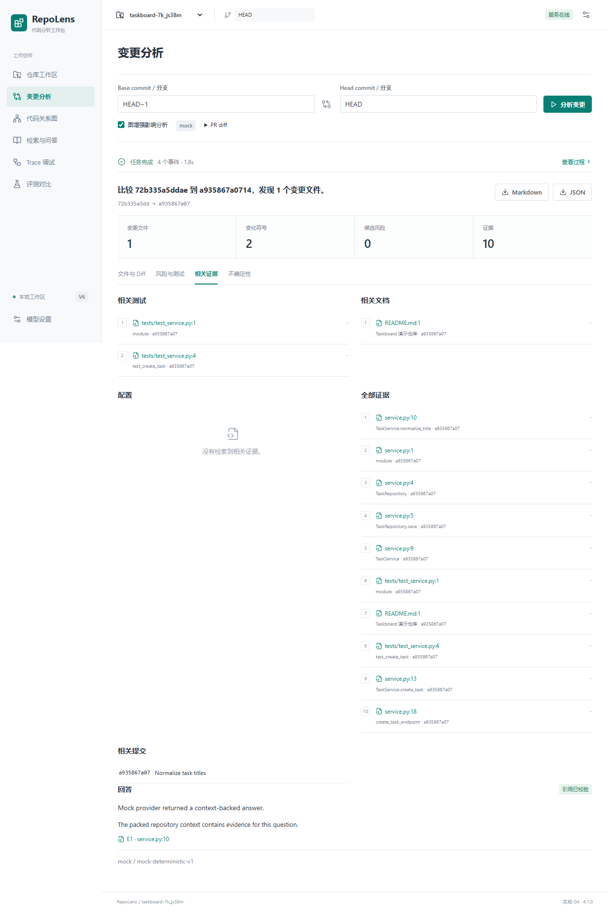
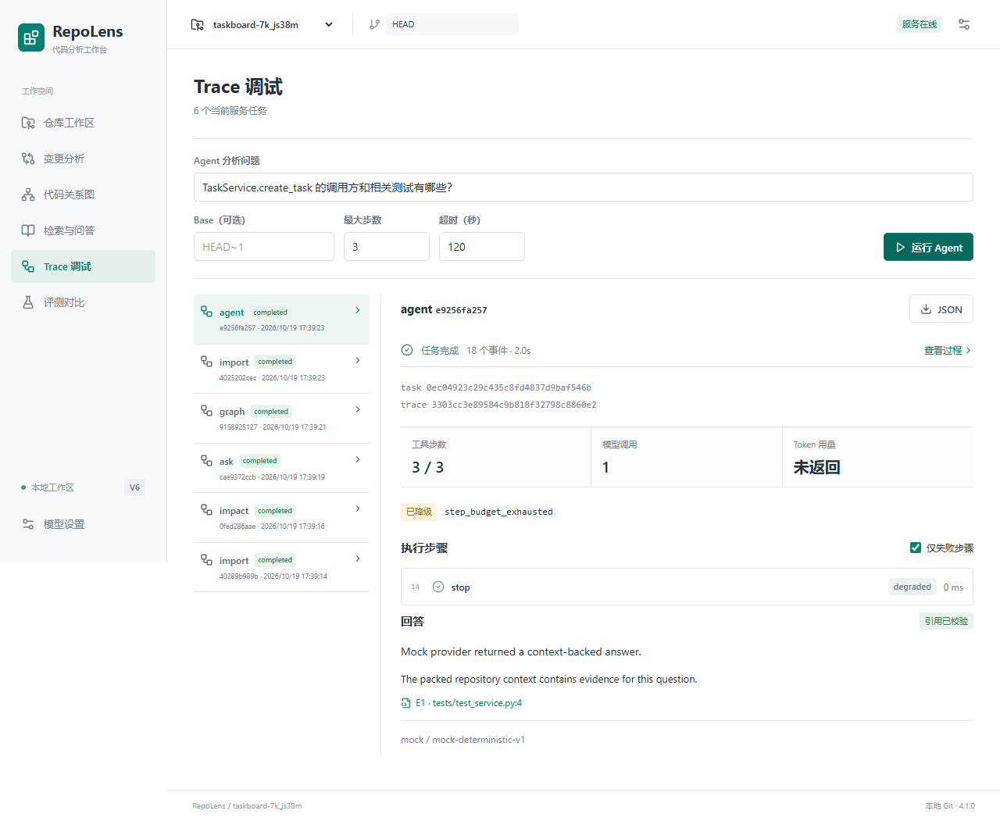
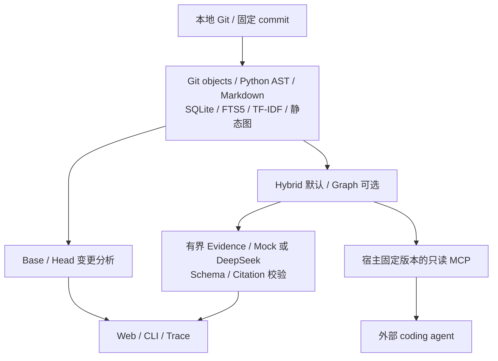

# RepoLens

**面向本地 Git 仓库的只读代码分析工作台：每条证据都能追溯到确切的 commit、文件、符号与行号。**

[](https://github.com/Zhang-J1a/RepoLens/actions/workflows/ci.yml)
[](pyproject.toml)
[](docs/architecture.md)
[](pyproject.toml)

[快速开始](#快速开始) · [评测结果](#评测结果) · [架构](#架构) · [使用文档](docs/usage.md) · [设计决策](docs/adr/) · [English](#english)


*截图来自项目自带 Taskboard 合成演示，路径已替换为示例值。*

## 解决什么问题

阅读陌生仓库时，函数名搜索、跨文件关系、历史版本与模型回答往往分散在不同工具里。RepoLens 将它们放进同一个本地工作台：选定 Git commit，检索源码，查看关系和变更，再沿引用回到原始证据。

- **版本可查证**：读取 committed Git objects，未提交修改和未跟踪文件不会混入历史 snapshot；返回引用前校验源码范围。
- **检索有对照**：保留 keyword、TF-IDF、hybrid、graph 四条路径及冻结评测。图检索在跨文件题上改善，也在通用题上回退，因此默认仍为 hybrid。
- **Agent 有边界**：固定只读工具、任务预算、进程超时和 Trace；没有证据时可在调用模型前拒答。

与完整仓库长上下文相比，RepoLens 提供可重复的版本选择和有限证据上下文；与普通向量库 Demo 相比，它还处理 symbol、commit history、变更影响、证据校验和权限边界。**当前尚未完成 full-context 的真实模型对照，不能据此宣称准确率或成本优于长上下文。**

## 快速开始

### Web 工作台

需要 Git、Docker Engine / Docker Desktop 与 Compose v2。三条命令启动；首次构建需要联网获取镜像和依赖：

```sh
git clone https://github.com/Zhang-J1a/RepoLens.git
cd RepoLens
docker compose up --build
```

打开 **<http://127.0.0.1:8770/>**，点击“打开演示仓库”，即可查看索引、变更、关系图、问答和 Trace。默认 Mock 不需要 API Key；它验证流程，回答不代表真实模型能力。

分析自己的仓库时，需要额外配置只读挂载；不要直接在容器中填写宿主机路径。配置及端口冲突处理见[部署文档](docs/deployment.md)。

### 无 Docker：先体验核心 Demo

在已下载源码的根目录执行，要求 Python 3.12+、Git、pip 和 SQLite FTS5。以下为 Windows PowerShell；安装步骤可能联网获取构建工具：

```powershell
python -m venv .venv
.\.venv\Scripts\python.exe -m pip install .
.\.venv\Scripts\python.exe -I scripts/demo.py
```

Linux/macOS 将 `.\.venv\Scripts\python.exe` 换成 `.venv/bin/python`。Demo 在临时 Git 仓库验证索引、检索与引用，退出后清理；核心运行时无第三方依赖。

完整 Web 的源码安装、首次前端构建、Windows 双击启动及 DeepSeek 配置见[使用文档](docs/usage.md)。双击 `RepoLens.pyw` 需要先完成 Web 环境准备；仓库不附带虚拟环境或预构建 wheel。

## 能做什么

| 工作流 | 输出 | 边界 |
|---|---|---|
| 仓库索引与搜索 | 固定 snapshot 的文件、symbol、源码范围 | 当前结构化支持 Python / Markdown |
| 证据问答 | 结构化 claims、canonical citations、未确定事项 | 引用定位有效不等于语义正确 |
| 变更影响分析 | base/head diff、变化 symbol、相关测试/文档、规则风险 | 静态推断，不执行测试，不承诺完整影响召回 |
| 代码关系图 | 有来源的 imports / calls / inheritance 等关系 | 动态分派与歧义保留 unknown |
| 受控 Agent | 八个只读工具、共享预算、超时与 Trace | 不提供 shell、写代码或依赖安装工具 |
| 评测回放 | 固定题集、策略 hash、逐题改善与回退 | 单仓库结果不代表跨仓库泛化 |

<details>
<summary>查看变更分析与 Agent Trace 截图</summary>





</details>

## 评测结果

固定仓库：`pallets/flask`，commit **`d086db856be187255b8ec61ef409357393020f32`**。各策略在相同题集、snapshot 和 top-10 设置下比较。vector 为本地 **TF-IDF 稀疏向量**，不使用神经网络 dense embedding。

| 题集 | 题数 | TF-IDF Recall@10 | Hybrid Recall@10 | Graph Recall@10 |
|---|---:|---:|---:|---:|
| 跨文件 authored 题集 | 10 | 0.8000 | 0.8500 | **0.9500** |
| 同仓库通用验证集 | 20 | 0.5333 | **0.6083** | 0.5000 |

跨文件题上 graph 相对 hybrid 提升 **0.10**；通用题上下降 **0.1083**，因此保留为显式选项。图扩展增加计算量，不能只比较召回而忽略延迟。逐题失败、参数、manifest 和原始结果见 [V4 评测报告](docs/evaluation-graph-v4.md)。

三项可核对的工程证据：

1. **90 次冻结检索回放**：两套题集、三种策略，逐题 Recall / MRR / nDCG 与冻结记录一致，见[回放报告](eval/v6-retrieval-regression.json)。
2. **跨平台 CI 已通过**：Windows / Ubuntu × Python 3.12 / 3.13，以及可选 LangChain、Web / 浏览器 / Docker，见[已通过的运行记录](https://github.com/Zhang-J1a/RepoLens/actions/runs/39374918498)。
3. **容器实际验证只读挂载**：CI 包含镜像构建、启动、合成 Demo、挂载导入及 `RW=false` 检查，见[工作流](.github/workflows/ci.yml)与[验收状态](docs/v6-release.md)。

这些是检索与工程验收证据。**多仓库外部盲测、真实模型回答正确率、引用语义支持度和真实负载性能仍未完成。** 当前按作者安排暂缓 M4 选仓，不以合成题或已参与开发的仓库补足数量。

## 架构



| 层 | 技术 | 选择原因 |
|---|---|---|
| 索引与存储 | Python 标准库、AST、SQLite / FTS5 | 本地可重建、事务一致性、无独立数据库服务 |
| 检索 | BM25、TF-IDF cosine、RRF、持久化静态图 | 基线可解释，实验可冻结并保留回退 |
| 模型 | DeepSeek API；可选 LangChain Core / LCEL / Retriever | 模型适配与版本、证据、权限边界分离 |
| 后端 | 可选 FastAPI、Pydantic、SSE | 封闭 API schema 与后台任务进度 |
| 前端 | React、TypeScript、TanStack Query、Monaco、React Flow | 仓库、diff、图、问答、Trace 与评测六页面 |
| Agent 接口 | MCP stdio / JSON-RPC、现有受控工具 | 固定版本、只读权限与进程预算复用 |
| 验证与部署 | unittest、Playwright、GitHub Actions、Docker | 离线契约、安装包、浏览器与容器分别验收 |

Agent 使用现有显式状态机与固定工具；LangChain 负责可选模型编排及 Document 适配。架构边界与取舍见[架构说明](docs/architecture.md)及 [ADR 目录](docs/adr/)。

## 限制与路线图

- 结构化解析仅支持 `.py` / `.md` / `.markdown`；中文问题采用有限词典扩展，不是通用翻译或 dense 语义检索。
- 静态图不保证动态调用、反射或跨语言关系完整；测试引用不等于测试执行或覆盖率。
- Citation validator 校验定位与版本，不证明 claim 被源码语义支持；真实模型评测单独进行。
- 当前是本地单用户工具，绑定 loopback；不声明多租户、公网认证或生产服务 SLO。
- 索引限制：单文件 1 MiB、源码总量 64 MiB、tree 50,000 条；不跟随 symlink 或 submodule，不联网补 Git objects。
- 同一数据库的 BM25 统计跨 snapshot 共享；可比实验需使用隔离、固定的索引 corpus。

| 优化项 | 当前状态 |
|---|---|
| 跨平台 CI、独立 wheel、容器与只读挂载 | 已有实际验收记录；本机无 Docker，容器证据来自 CI |
| 多仓库外部盲测 M4 | 输入预检已实现，选仓与真实盲测暂缓 |
| 真实模型评测 M5 | 已补齐运行入口、断点预算、独立审阅模板与拒答/引用支持度评分；真实调用与人工质量标签待完成 |
| Dense embedding / reranker / 检索路由 M6 | 等待 M4 / M5 基线，当前未启用 |
| 只读 MCP 接口 M7 | stdio 最小服务与子进程测试已实现；第三方客户端互操作待验收 |
| 多语言 M8 | 待独立决策与真实仓库验证 |

## 开发与文档

```powershell
$env:PYTHONPATH = "src"
python -m unittest discover -s tests -v
python scripts/v6_regression.py
```

测试默认离线，Git 集成使用临时仓库；安装 Web / LangChain 可选依赖后才执行对应测试。安装、构建、验证矩阵和提交约定见 [CONTRIBUTING.md](CONTRIBUTING.md)。

| 文档 | 内容 |
|---|---|
| [使用指南](docs/usage.md) | 首次启动、索引、问答、DeepSeek 与常见问题 |
| [部署与回滚](docs/deployment.md) | 源码构建、Docker、只读挂载与排障 |
| [架构与 ADR](docs/architecture.md) | 模块职责、版本身份与设计决策 |
| [评测协议](docs/evaluation-dataset.md) | 数据集、指标分母、冻结与复现 |
| [模型评测准备](docs/generation-benchmark.md) | Mock/真实 provider 执行器、断点恢复、预算与独立审阅导出 |
| [只读 MCP](docs/mcp.md) | 外部 Agent 接入、固定版本与工具预算 |
| [维护性审查](docs/maintenance-review.md) | 模块测量、兼容取舍与质量门禁 |
| [验收记录](docs/v6-release.md) | 本地、安装包、CI 与容器证据 |
| [面试与演示](docs/interview-guide.md) | 五分钟演示、设计取舍与结果表述 |
| [优化计划](docs/portfolio-optimization-plan.md) | 作品集目标、依赖条件与完成定义 |
| [进度交接](docs/progress.md) | 有日期的执行记录与后续任务 |

## 源码许可

本仓库公开用于展示与审阅。**作者当前暂不添加 LICENSE，未授予开源许可。** 项目自有源码与依赖、评测对象的许可分别适用；不在仓库中再分发上游源码、索引数据库或密钥。

## English

RepoLens is a local, read-only code analysis workbench for Git repositories. It binds Python / Markdown evidence to exact commits, combines lexical and TF-IDF retrieval with an optional static graph, and provides citation-validated answers, commit impact analysis and a budgeted agent. The React / FastAPI workbench includes repository, diff, graph, Q&A, trace and evaluation views.

Cross-platform CI and container smoke checks have passed. Graph retrieval improves a ten-question Flask cross-file benchmark but regresses on the twenty-question general validation set, so hybrid remains the default. External multi-repository testing and independently reviewed real-model answer quality are still pending. No open-source license has been granted.
