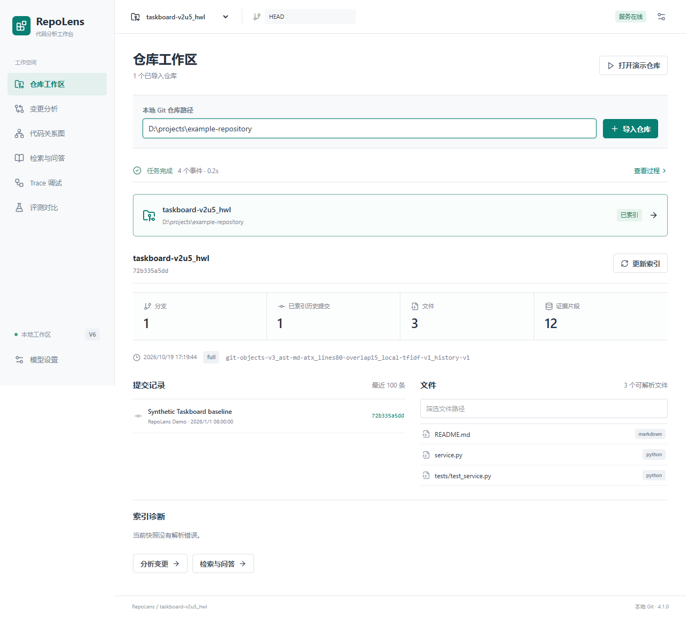
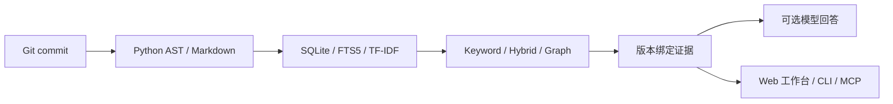

# RepoLens

**面向本地 Git 仓库的只读代码分析工作台，检索结果绑定到确切的 commit 与源码位置。**

[](https://github.com/Zhang-J1a/RepoLens/actions/workflows/ci.yml)
[](pyproject.toml)
[](docs/architecture.md)



*截图使用项目内置的 Taskboard 合成仓库。*

RepoLens 从已提交的 Git 对象构建索引，可搜索代码、查看关系和变更，并将结果定位回 commit、文件、符号与行号。分析过程中不会执行目标仓库代码。

## 功能范围

| 工作流 | 输出 | 边界 |
|---|---|---|
| 索引与搜索 | 固定 snapshot 下的文件、符号和证据 | 结构化解析目前支持 Python 与 Markdown |
| 证据问答 | 结构化回答与规范化源码引用 | 引用位置有效不等于结论受源码语义支持 |
| 变更分析 | base/head diff、相关符号、测试与文档 | 静态分析，不执行测试 |
| 代码关系 | 版本绑定的 import、调用和继承关系 | 动态分派及歧义关系可能无法确定 |
| 受控 Agent | 固定只读工具、步骤与时间预算 | 不提供 shell、写文件或安装依赖的工具 |

## 检索结果

以下对照使用固定 Flask snapshot：`d086db856be187255b8ec61ef409357393020f32`。Vector 基线是本地 TF-IDF，不是神经网络 embedding。

| 题集 | 题数 | TF-IDF Recall@10 | Hybrid Recall@10 | Graph Recall@10 |
|---|---:|---:|---:|---:|
| 跨文件问题 | 10 | 0.8000 | 0.8500 | **0.9500** |
| 同仓库通用问题 | 20 | 0.5333 | **0.6083** | 0.5000 |

Graph 在跨文件题集上提升召回，在通用题集上回退，因此默认仍使用 Hybrid。以上是单仓库检索结果，不是回答准确率，也不能证明跨仓库泛化。逐题结果和限制见[评测报告](docs/evaluation-graph-v4.md)。

[最新 GitHub Actions 运行](https://github.com/Zhang-J1a/RepoLens/actions/runs/39752682525)的 6 个 job 全部通过，覆盖 Windows/Ubuntu、Python 3.12/3.13、LangChain、Web 工作台、浏览器和容器检查。本地完整回归及环境条件跳过项见[进度记录](docs/progress.md)。

## 运行演示

需要 Git、Docker Engine 和 Compose v2：

```sh
git clone https://github.com/Zhang-J1a/RepoLens.git
cd RepoLens
docker compose up --build
```

打开 <http://127.0.0.1:8770/>，选择“打开演示仓库”。内置演示使用确定性的 Mock provider，不需要 API Key；它用于验证工作流和引用契约，不代表真实模型质量。

不使用 Docker 时，可用 Python 3.12+、Git、pip 和 SQLite FTS5 运行核心演示：

```powershell
python -m venv .venv
.\.venv\Scripts\python.exe -m pip install .
.\.venv\Scripts\python.exe -I scripts/demo.py
```

自己的 Git 仓库、Web 环境准备和可选 DeepSeek 配置见[使用指南](docs/usage.md)。Docker 分析用户仓库时，需按[部署指南](docs/deployment.md)显式配置只读挂载。

## 设计



| 模块 | 技术 |
|---|---|
| 索引与存储 | Python 标准库、AST、SQLite、FTS5 |
| 检索 | BM25、本地 TF-IDF、倒数排名融合、可选静态图 |
| 模型适配 | DeepSeek provider；可选 LangChain Core、LCEL 和 Retriever |
| 工作台 | FastAPI、React、TypeScript、Monaco、React Flow |
| Agent 接口 | 显式状态机、固定工具、共享预算、MCP stdio |
| 验证与部署 | `unittest`、Playwright、GitHub Actions、Docker |

模型是可选项。RepoLens 校验输出结构和引用是否属于选定 snapshot；引用的语义支持仍需独立审阅。实现细节见[架构说明](docs/architecture.md)和[设计决策](docs/adr/)。

## 限制

- 尚未完成外部多仓库盲测；M4 目前暂缓。
- 尚无真实模型回答准确率、引用语义支持度或成本报告；生成评测器目前由 scripted 案例验证。
- 结构化解析支持 Python 和 Markdown，暂不支持 TypeScript 或 Java。
- 当前是本地单用户工具，不声明公网认证、多租户或生产 SLO。
- 仓库未添加开源许可证，不授予复用项目源码的许可。

## 文档

- [使用指南](docs/usage.md)
- [架构说明](docs/architecture.md)
- [检索评测](docs/evaluation-graph-v4.md)
- [生成评测准备](docs/generation-benchmark.md)
- [部署指南](docs/deployment.md)
- [面试与演示](docs/interview-guide.md)
- [优化计划](docs/portfolio-optimization-plan.md)
- [进度与验收记录](docs/progress.md)

## English Summary

RepoLens is a local, read-only code analysis workbench for Git repositories. It binds Python and Markdown evidence to exact commits, combines lexical and TF-IDF retrieval with an optional static graph, and provides citation-validated answers, change analysis, and a bounded agent. Multi-repository blind evaluation and independently reviewed real-model answer quality remain incomplete.
